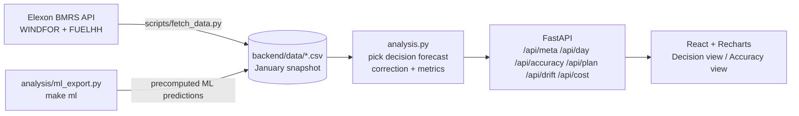

# Wind Forecast Desk

[](https://github.com/AdityaMedidala/drluam/actions/workflows/ci.yml)

A web app for a UK utility's day-ahead power buying team. It answers two questions:

1. **What was the latest wind forecast available when we had to decide?** For each delivery day, it shows the forecast the desk could actually see before the day-ahead auction closed. It also shows an adjusted forecast and an uncertainty band.
2. **How much can we trust it?** Accuracy of those decision-time forecasts across January 2026: bias, MAE, error ranges, and breakdowns by lead time, wind level and hour of day.

**Two models.** A Model switch in the control bar chooses between them:
- **Simple** is the default and the basis of every headline number below. It is a 7-day ratio correction with a residual band.
- **ML** (LightGBM + CQR) is an optional challenger, precomputed for January at the 09:00 / 09:20 decision times.

On an unseen year, 2024, ML's 80% range covered 80.0% of hours, and its pinball loss was 55 MW lower than Simple's [−81, −31]. Why it is optional and not the default: [ADR-001](docs/decisions.md).

**Live app:** https://drluam.vercel.app
**Pilot brief for the client (2 pages):** [docs/pilot-brief.pdf](docs/pilot-brief.pdf) ([Markdown source](docs/pilot-brief.md))
**Video walkthrough:** _<add unlisted YouTube URL>_

---

## Key findings (January 2026 decisions, 09:20 UK cutoff, the EPEX gate)

| | Raw forecast | Adjusted forecast |
|---|---|---|
| Typical hourly error (MAE) | 2,022 MW | 1,383 MW (−32%) |
| Average bias (forecast − actual) | +1,746 MW | +320 MW (~82% removed) |
| Error as share of output | 17.9% | 12.3% |
| Hours over-forecast | 85% | 55% |

*Raw and adjusted are compared on the same 744 hours (31 delivery days, each with a full week of history).*

- The forecast available at decision time was **too high in 85% of hours**, by +1,746 MW on average. A desk buying against it would have consistently under-bought.
- **The correction removes ~82% of the bias and cuts typical error by ~32%; it beat the raw forecast on 22 of 31 days.**
- The over-forecast appears at **every lead time, about 1.5–2 GW, even for hours that had already happened** when the forecast was published (+1.7 GW). So it is mostly not forecasting skill. It is a systematic gap between what WINDFOR forecasts and what FUELHH reports as generated. The likely cause is curtailment: an outside check with Elexon's accepted bid volumes for wind farms (docs/curtailment-check.md) finds wind was turned down by 1.5 GW on average in January, about 87% of the average gap (hour by hour the error falls 43%). That data is outside the brief, so the app doesn't use it.
- The gap grows with wind level: about +2.7 GW when the forecast is above 15 GW (still about +1.0 GW after the correction).
- **The uncertainty band under-covers: the actual fell inside it in 69% of hours, against an 80% target.** See *Limitations*.

## How it works



**Picking the decision forecast.** GB day-ahead auctions close around 09:20–09:50 UK time on the day before delivery. For every target hour on delivery day D, the app uses the **latest WINDFOR forecast published at or before the cutoff on D−1** (default 09:20 UK, the EPEX gate closure, adjustable in the UI). No WINDFOR run is published between 09:00 and 09:20 UK in any month fetched, so 09:20 gives the same results as 09:00, and the 09:00-based analyses in `docs/` apply unchanged. The 09:50 option (the N2EX gate) shows what waiting buys: it picks up the 09:30 run, which moves January raw MAE from 2,022 to 1,996 MW and band coverage from 69.1% to 69.4%. Forecasts published later are ignored, because the desk could not have used them. Using the newest forecast instead would overstate accuracy.

**Scope.** "Decisions made in January 2026" means delivery days **2 Jan – 1 Feb 2026**.

**Delivery day.** A delivery day is the UK calendar day (00:00–24:00 Europe/London). GB day-ahead auction products actually run 23:00–23:00 UK; re-running with that definition changed raw bias and MAE by less than 0.2% and adjusted MAE by about 1% (1,383 → 1,369 MW), so the simpler calendar day is kept.

**Time alignment.** WINDFOR is hourly and FUELHH is half-hourly. Accuracy is measured on the hour. Interpolating forecasts to half-hours gave the same results (MAE 2,021 vs 2,022 MW). Charts show actuals at full half-hourly resolution.

**Adjusted forecast and band.** For delivery day D: ratio = Σactual / Σforecast over the previous 7 days of hours whose actuals were already known at the cutoff. Adjusted forecast = forecast × ratio. The band is the adjusted forecast + the P10/P90 of out-of-sample residuals over that same window: for each history hour, actual minus that day's own adjusted forecast (made with its own prior ratio), so the band reflects errors the method really made. In January the actual fell inside the band in 69% of hours at the 09:20 cutoff, not the nominal 80%; the app shows the measured figure. A test checks that nothing from after the cutoff is used.

**When an actual counts as known.** A FUELHH half-hour is treated as known once it has ended (startTime + 30 min ≤ cutoff), i.e. assuming it is published with no lag. The snapshot supports this: 99.8% of half-hours carry a publishTime within 5 minutes of the period end. If Elexon's real availability lagged, the last half-hour or so before the cutoff would drop out of a 168-hour window.

**Error sign.** Error = forecast − actual. Positive means the forecast was too high, i.e. the risk of buying too little.

**Times.** All times are stored in UTC and shown in UK local time. Delivery days and cutoffs are handled in `Europe/London`, so the logic stays correct during British Summer Time (covered by a test).

## Repository layout

```
.
├── .github/workflows/
│   ├── ci.yml               # on push: backend pytest, frontend build, Playwright with axe
│   └── smoke.yml            # manual: smoke-test a deployed URL
├── backend/
│   ├── app/
│   │   ├── analysis.py      # core logic: decision-forecast selection, correction, metrics, cost (pure pandas)
│   │   ├── data.py          # loads the CSV snapshot, the ML predictions and the provenance checksums
│   │   └── main.py          # FastAPI routes under /api (model=simple|ml)
│   ├── data/                # January 2026 snapshot from Elexon (actuals_wind.csv, forecasts_wind.csv, manifest.json)
│   │                        # + the optional ML model, precomputed: ml_predictions.csv, ml_development.json
│   ├── scripts/
│   │   ├── fetch_data.py    # pulls WINDFOR + FUELHH from the Elexon API (chunked, with retries)
│   │   └── explore_data.py  # data profiling: publish schedule, resolution, horizons, first metrics
│   ├── tests/               # pytest: selection and no-leakage (analysis), API, golden README numbers, plan,
│   │                        # cost, drift, ML model, data manifest and provenance checksums
│   ├── Dockerfile
│   ├── requirements.txt     # runtime deps
│   └── requirements-dev.txt # + fetch script and test deps
├── frontend/
│   ├── src/
│   │   ├── main.tsx         # entry point
│   │   ├── App.tsx          # Carbon UI shell, page header and controls
│   │   ├── api.ts           # typed API client
│   │   ├── components/      # DecisionView, PlanPanel, CostPanel, DriftPanel, AccuracyView, ModelComparison, shared ui.tsx
│   │   ├── app.scss         # Carbon styles (only the components used) and layout
│   │   ├── format.ts        # number/time formatting (UK time)
│   │   ├── model.ts         # Simple / ML model switch and its labels
│   │   ├── theme.ts         # chart colours (colour-blind safe, light/dark)
│   │   └── url.ts           # view state kept in the URL
│   ├── e2e/smoke.spec.ts    # Playwright end-to-end tests with axe accessibility checks
│   ├── playwright.config.ts # starts its own backend and Vite server for the e2e tests
│   ├── package.json, vite.config.ts, tsconfig.json, index.html   # Vite + React + TypeScript build
│   ├── Dockerfile           # build with Node, serve with nginx
│   └── nginx.conf           # serves the SPA, proxies /api to the backend
├── analysis/                # out-of-app studies, ml_export.py (`make ml`), reproduce.py (`make reproduce`),
│                            # tests/, recorded confirmation results, data manifests; the CSVs are not in git
├── docs/                    # decisions (ADRs), pilot brief (.md + .pdf), studies, data-usage, research and time logs
├── scripts/
│   ├── smoke_test.sh        # smoke-test a deployment (`make smoke URL=…`)
│   └── render_pilot_brief.cjs # renders docs/pilot-brief.md to PDF with Playwright
├── Makefile                 # dev, test, data, ml, smoke, reproduce, reproduce-app (see "Make targets")
├── docker-compose.yml
└── vercel.json              # Vercel Services: frontend at /, FastAPI at /api
```

## Running it

### Make targets

| target | what it does | time (measured) |
|---|---|---|
| `make dev` | backend on :8000 with reload, frontend on :5173 (proxies `/api`); Ctrl-C stops both | – |
| `make test` | backend pytest, analysis tests (incl. the `make ml` regeneration check), Playwright e2e with axe | ~3 min |
| `make data` | re-fetch the app's January snapshot from Elexon into `backend/data` (rewrites its manifest) | ~15 s |
| `make ml` | regenerate the precomputed ML predictions (`backend/data/ml_predictions.csv`, ADR-001) | ~2.5 min |
| `make smoke URL=…` | smoke-test a deployment (`scripts/smoke_test.sh`) | ~5 s |
| `make reproduce-app` | fast check: fetch the app snapshot, compare its sha256 with the manifest, check the README headline numbers on it, run the backend tests | ~20 s |
| `make reproduce` | full check, described below | ~40 min |

`make reproduce` (`analysis/reproduce.py`) rebuilds every number from Elexon:
1. It fetches every period the docs use, plus the curtailment and NESO inputs, and compares each file's sha256 with its committed manifest. A file Elexon has since revised is reported by name as REVISED, and the checks run on the fetched data.
2. It reruns every study.
3. It runs the three pre-registered confirmations (vault, October 2026, 2024) in a **verify mode**. That recomputes them and compares with the recorded results, so it is not a new confirmation run.
4. It checks every number each study prints against its doc, plus a registry of prose claims in the README and the ADR.
5. It runs the backend and analysis tests, then prints a pass/fail table.

A changed file is reported by name. **EXTENDED** means Elexon only added rows past the recorded range, for example a day that has finished since; the checks then use the recorded rows. **REVISED** means recorded values changed; the checks run on the fetched copy and the original is restored afterwards. Measured on a 10-core laptop on 25 Oct 2026, the full run took 39 min wall-clock: about 12 min of Elexon downloads and 9 min of studies and tests. It reported `analysis/data-2026-10/actuals_wind.csv` as extended (24 Oct had finished since the fetch), and every other file was identical. `--skip-fetch` runs the same checks on the local data in about 9 min. Determinism comes from the pinned versions in `analysis/requirements.txt`, with LightGBM run with `deterministic=True`, fixed seeds and row-wise training.

### With Docker (recommended)

```bash
docker compose up --build
```

Open http://localhost:8080. The API is also on http://localhost:8000 (docs at `/docs`).

### Without Docker

```bash
# backend
cd backend
python -m venv .venv && source .venv/bin/activate   # Windows: .venv\Scripts\activate
pip install -r requirements-dev.txt
uvicorn app.main:app --reload --port 8000

# frontend (second terminal)
cd frontend
npm install
npm run dev          # http://localhost:5173, proxies /api to :8000
```

### Tests

```bash
cd backend && pytest
```

### Refreshing the data

The app serves a committed snapshot, because January 2026 is historical and fixed. This keeps the app fast and independent of the Elexon API's uptime. To re-pull it:

```bash
python backend/scripts/fetch_data.py
python backend/scripts/explore_data.py   # sanity-check what came back
```

The analysis data in `analysis/` (about 20 MB) is not in git. Only each directory's `manifest.json` is committed, with the row counts and a sha256 for each CSV. To rebuild it:

```bash
python backend/scripts/fetch_data.py --first-delivery 2025-11-02 --last-delivery 2026-04-01 --out-dir analysis/data
python backend/scripts/fetch_data.py --first-delivery 2026-04-02 --last-delivery 2026-10-01 --out-dir analysis/data-2026-04-09
python backend/scripts/fetch_data.py --first-delivery 2025-01-02 --last-delivery 2025-11-01 --out-dir analysis/vault-2025
git diff analysis/*/manifest.json   # only fetchedAt should change; a sha256 change means Elexon revised the data
```

The ML model's predictions are regenerated from that analysis data with `make ml` (needs `pip install -r analysis/requirements-ml.txt`). The app itself never runs a model or imports LightGBM. `analysis/tests/test_ml_export.py` checks that a regeneration matches the shipped `backend/data/ml_predictions.csv`.

## Deployment

Deployed on Vercel as one project using [Vercel Services](https://vercel.com/docs/services). The Vite frontend serves `/`, and the FastAPI backend serves `/api/*` (see `vercel.json`). Import the repo in Vercel with the Root Directory left at the repo root and the Framework Preset set to Services. With Root Directory `frontend`, Vercel never reads `vercel.json`, so only the frontend builds and every `/api` call returns 404.

Check a deployment with `scripts/smoke_test.sh https://drluam.vercel.app`. It checks health, meta, day, plan, accuracy and the page. The "Smoke test" GitHub Actions workflow runs it on demand.

## Design decisions and trade-offs

- **Snapshot instead of live API calls.** The data is fixed history, so a snapshot gives fast, reproducible results. A production version would refresh on a schedule.
- **Pandas in memory, no database.** About 30k rows. Results are cached per cutoff. A database would add moving parts without benefit at this size.
- **Analysis logic kept free of I/O.** All of it lives in `analysis.py`, so it can be unit-tested directly.
- **ML as an optional, precomputed challenger** ([ADR-001](docs/decisions.md)). The predictions ship as a checksummed CSV, so there is no ML at runtime. Simple stays the default because adding ML deviates on purpose from the project's data-usage rule. Becoming the default would need a pre-registered trial on Nov 2026+ data.
- **Simple, explainable correction.** A multiplicative trailing ratio was chosen over a fitted model because the client can understand and audit it. A level-dependent correction is a natural next step, since the bias grows with wind level.

## Deeper analysis

Outside the app; each analysis runs the app's own logic unchanged on other months. Every study, its rule and its verdict are listed in [docs/research-log.md](docs/research-log.md).

- **[docs/curtailment-check.md](docs/curtailment-check.md): curtailment explains most of the gap.** Adding accepted wind bid volumes (Elexon BOAV, outside the brief) back to metered output cuts January's bias from +1,746 to +221 MW and MAE from 2,022 to 1,147 MW; at forecasts above 15 GW the gap drops to about zero, slightly overshooting (−263 MW). 28 Jan stays unexplained.
- **[docs/correction.md](docs/correction.md): the level-aware correction FAILED its pre-registered test** on the untouched Jan–Oct 2025 data: MAE lower in only 3 of 10 months (the rule needed 8) and |bias| worse in 9 of 10, so the app keeps the simple 7-day ratio. That vault is now spent; [docs/data-usage.md](docs/data-usage.md) records which data has been used, and future changes must be confirmed on Nov 2026+ data.
- [docs/validation.md](docs/validation.md): on Nov 2025 – Mar 2026 the correction removes 82–102% of the bias and cuts MAE by 10–54% in every month. The band under-covers everywhere (64–73% vs 80%). Against naive references (Nov 2025 – Sep 2026, day-block bootstrap): the correction beats the raw forecast by 30% pooled (95% CI +26% to +34%), with an interval above zero in 10 of 11 months (three only just), and both forecasts beat persistence in every month (raw by 42–69%, adjusted by 52–78%).
- [docs/error-anatomy.md](docs/error-anatomy.md): across Nov 2025 – Sep 2026 the error is mostly whole-day level, not timing (a per-day level fix would remove 55% of MAE, a time shift 17%). The forecast catches only half of >2 GW ramps.
- [docs/plan-backtest.md](docs/plan-backtest.md): the planning volume at each exceedance level is about right at P50 but under-covers in the tail. Across Nov 2025 – Sep 2026 the P90 planning volume had a hit rate of 84% and the P95 volume 89% (January: 82% and 89%).
- [docs/ml-challenger.md](docs/ml-challenger.md): **a LightGBM quantile challenger was not adoption-worthy** under its pre-registered rule. On October 2026 it had lower MAE (1,383 vs 1,533 MW) and pinball loss, both with intervals that include zero, but its 80% range held the outturn in only 49% of hours.
- [docs/cqr-2024.md](docs/cqr-2024.md): **LightGBM + CQR confirmed out-of-period on 2024** (one pre-registered run on an unseen year). Its 80% range covered 80.0% of hours, within 75–85% in 10 of 12 months. Pinball loss was 55 MW lower than the current method's [−81, −31]. It is now an optional ML model in the app, not the default ([ADR-001](docs/decisions.md)).
- [docs/cqr.md](docs/cqr.md): **conformal calibration of the LightGBM challenger is promising, unconfirmed (needs Nov 2026+ data).** Its 80% range covered 80% of development hours, against 55% raw and 71% for the current method. Pinball loss was 50 MW lower than the current method's. The monthly coverage rule was met by the bare minimum (8 of 11 months).
- [docs/cost-backtest.md](docs/cost-backtest.md): the cost-aware exceedance level (illustrative). At £100 short and £30 long per MWh the newsvendor ratio recommends P80, which was also the lowest-cost level pooled over Nov 2025 – Sep 2026. In January P70 cost least, £4.6m below P80. P80 would have cost £67m less than the NESO forecast in January in this backtest, at these assumptions.
- [docs/uncertainty.md](docs/uncertainty.md): three alternative bands were tested against a rule fixed in advance. None beat the current band on pinball loss, so it is kept.
- [docs/method-candidates.md](docs/method-candidates.md): the one change worth confirming later, a band built from 14 days of residuals, is **promising, unconfirmed**: it raised coverage in 10 of 11 months. Its adoption rule is written down for Nov 2026+ data; nothing new is adopted before submission.

## Limitations

- **The band holds the actual in 69% of hours, not 80%.** Errors are strongly correlated within a day, so the trailing week's 168 hourly residuals are really about seven day-sized draws, and the band under-covers when conditions shift between that week and the delivery day. On the worst days the actual fell outside the band in every hour: 2, 11, 21 and 28 Jan. Each was a day when the actual/forecast ratio dropped well below the trailing week's (28 Jan: 0.52 vs 0.87). The curtailment check (docs/curtailment-check.md) explains most of the miss on 2, 11 and 21 Jan, but not 28 Jan, where output was still only 65% of the forecast after adding curtailed volumes back.
- **One month.** All app figures are January 2026 only.
- **Summer run timing.** WINDFOR's run schedule shifts with British Summer Time. In winter the last run before the 09:20 UK cutoff is the 07:30 run; in summer there is no 07:30 run, so the decision uses the 06:30 run, an hour older. This doesn't affect the January app, but it matters if the scope extends into summer.

## Next steps

- Add more months to test whether the bias pattern persists.
- Add other renewables and demand forecasts, so the app shows the actual residual volume to buy.
- Recalibrate the exceedance levels so the P90 planning volume holds in about 90% of hours (today about 84%, `docs/plan-backtest.md`). This is a method change: it must be pre-registered and confirmed on Nov 2026+ data, because every earlier month has been used, so the app shows the measured hit rates instead.
- A better-calibrated band. Three reshaped bands failed (docs/uncertainty.md); the most promising lead, a 14-day residual window, is pre-registered for confirmation on Nov 2026+ data (docs/method-candidates.md).
- Forecast curtailment directly. Accepted wind bids account for about 87% of January's average gap (docs/curtailment-check.md), so a constraint or curtailment forecast is the most promising input for whole-day level errors. A simple level-banded ratio failed its test (docs/correction.md).
- Schedule automatic data refreshes.

## Use of AI tools

_<Fill in honestly — the challenge asks for this explicitly. For example: which parts you wrote, which parts an AI assistant (Claude) scaffolded or implemented, which parts you reviewed and changed, and what you used ChatGPT/Gemini for (e.g. domain research).>_
