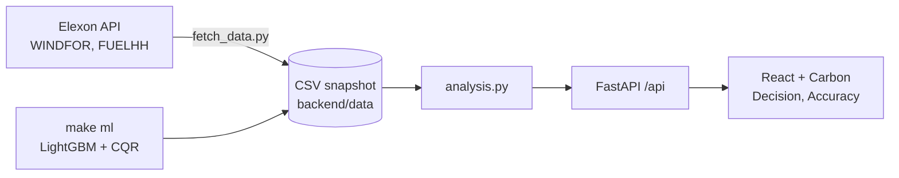

# Wind Forecast Desk

[](https://github.com/AdityaMedidala/drluam/actions/workflows/ci.yml)

**Live app:** https://drluam.vercel.app · **Video:** https://youtu.be/2jz2zNpDsmQ · **Client brief (2 pages):** [docs/pilot-brief.pdf](docs/pilot-brief.pdf)

Web app for a UK utility's day-ahead buying desk. For each delivery day it shows:

- the latest NESO wind forecast available before the 09:20 UK auction cutoff on the day before;
- a bias-corrected forecast, and the **P80 planning volume** (real wind was at or above it in about 80% of past hours);
- how accurate those forecasts were against actual wind in January 2026.

## Results (January 2026, 09:20 UK cutoff)

| | NESO forecast | Bias-corrected |
|---|---|---|
| Mean absolute error (MAE) | 2,022 MW | 1,383 MW (−32%) |
| Mean error (forecast − actual) | +1,746 MW | +320 MW (~82% removed) |
| Error as share of output | 17.9% | 12.3% |
| Hours over-forecast | 85% | 55% |

Raw and adjusted are compared on the same 744 hours (31 delivery days, each with a full week of history).

- The NESO forecast was too high in 85% of hours. A desk buying against it would under-buy.
- The correction beat the raw forecast on 22 of 31 days.
- Likely cause: curtailment (wind farms paid to switch off when the grid is congested). Accepted wind bids match about 87% of the gap ([docs/curtailment-check.md](docs/curtailment-check.md)).
- The uncertainty band is too narrow: actual wind fell inside it in 69% of hours, not 80%. The app shows the measured figure.

## Architecture



## Method

1. **Decision forecast.** For each delivery hour, take the latest WINDFOR run published at or before 09:20 UK on D−1 (cutoff adjustable in the app). Later runs are ignored.
2. **Ratio.** Actual ÷ forecast over the previous 7 days, using only actuals already published at the cutoff.
3. **Bias-corrected forecast** = NESO forecast × ratio.
4. **P-levels and 80% range** = corrected forecast + percentiles of the previous 7 days' misses (for P80, the 20th percentile, floored at zero; the range uses the 10th and 90th).
5. **Cost-aware level.** Recommended level = short cost ÷ (short + long cost). At £100 short and £30 long this gives P77, shown as P80. Over Nov 2025–Sep 2026, P80 was the cheapest level, £694m below using the NESO forecast as is, at national scale and assumed prices ([docs/cost-backtest.md](docs/cost-backtest.md)).

All times are stored in UTC and handled in `Europe/London`, including the March clock change.

**ML model (optional, selectable in the app).** LightGBM quantile regression with conformal calibration (CQR), trained on 2023 onwards. Predictions are precomputed and shipped as a checksummed file, so nothing runs at request time. On the unseen year 2024 its 80% range held 80.0% of hours ([docs/cqr-2024.md](docs/cqr-2024.md)). Simple stays the default ([ADR-001](docs/decisions.md)).

## Testing and evidence

- **No-leakage test.** Feeds very different future actuals into the correction and checks the output is unchanged (`backend/tests/`).
- **Time handling.** A test covers the 29 March 2026 clock change.
- **Golden-number tests** pin every headline figure in this README.
- **Browser tests** (Playwright) with accessibility checks, plus a smoke test of the live site and CI on every push.
- **Pre-registered studies.** Each method change had a pass/fail rule written before the result. Some failed (a level-aware correction on held-out 2025 data; an uncalibrated LightGBM, whose 80% range held 49% of hours). Every study and verdict: [docs/research-log.md](docs/research-log.md).

## Run

```bash
docker compose up --build   # http://localhost:8080, API docs on :8000/docs
```

Without Docker:

```bash
cd backend && python -m venv .venv && source .venv/bin/activate
pip install -r requirements-dev.txt && uvicorn app.main:app --reload --port 8000
cd frontend && npm install && npm run dev      # http://localhost:5173
```

| Command | What it does | Time |
|---|---|---|
| `make dev` | backend :8000, frontend :5173 | – |
| `make test` | backend, analysis and browser tests | ~3 min |
| `make data` | refetch the January snapshot from Elexon | ~15 s |
| `make ml` | regenerate the ML predictions | ~2.5 min |
| `make smoke URL=…` | smoke-test a deployment | ~5 s |
| `make reproduce-app` | refetch the data, compare checksums, check README numbers, run backend tests | ~20 s |
| `make reproduce` | rebuild every documented number from Elexon | ~40 min |

`make reproduce` checks table numbers one by one, prose numbers by presence, and key claims through a registry. The data stays in the repo as a snapshot because January 2026 is fixed history.

Deployed on Vercel as two services: the Vite frontend at `/`, FastAPI at `/api` (`vercel.json`).

## Files

```
.
├── .github/workflows/
│   ├── ci.yml               # on push: backend pytest, frontend build, Playwright with axe
│   └── smoke.yml            # manual: smoke-test a deployed URL
├── backend/
│   ├── app/
│   │   ├── analysis.py      # core logic: forecast selection, correction, metrics, cost (pure pandas)
│   │   ├── data.py          # loads the CSV snapshot, ML predictions and checksums
│   │   └── main.py          # FastAPI routes under /api (model=simple|ml)
│   ├── data/                # Elexon snapshot + precomputed ML predictions + manifest.json
│   ├── scripts/
│   │   ├── fetch_data.py    # pulls WINDFOR + FUELHH from Elexon (chunked, with retries)
│   │   └── explore_data.py  # data profiling
│   ├── tests/               # pytest: selection, no-leakage, API, golden numbers, plan, cost, drift, ML, provenance
│   ├── Dockerfile
│   ├── requirements.txt     # runtime deps
│   └── requirements-dev.txt # + fetch script and test deps
├── frontend/
│   ├── src/
│   │   ├── main.tsx, App.tsx          # entry point, Carbon shell and controls
│   │   ├── api.ts                     # typed API client
│   │   ├── components/                # DecisionView, PlanPanel, CostPanel, DriftPanel, AccuracyView, ModelComparison, ui.tsx
│   │   ├── app.scss                   # styles and layout
│   │   ├── format.ts, model.ts        # formatting (UK time), Simple/ML switch
│   │   ├── theme.ts, url.ts           # chart colours, view state in the URL
│   ├── e2e/smoke.spec.ts    # Playwright end-to-end tests with axe
│   ├── playwright.config.ts
│   ├── package.json, vite.config.ts, tsconfig.json, index.html
│   ├── Dockerfile           # build with Node, serve with nginx
│   └── nginx.conf           # serves the app, proxies /api to the backend
├── analysis/                # studies, ml_export.py (`make ml`), reproduce.py (`make reproduce`), tests; CSVs not in git
├── docs/                    # decisions (ADRs), pilot brief (.md + .pdf), studies, data-usage, research and time logs
├── scripts/
│   ├── smoke_test.sh        # smoke-test a deployment
│   └── render_pilot_brief.cjs
├── Makefile
├── docker-compose.yml
└── vercel.json
```

## Limitations

- **One month.** App figures are January 2026 only.
- **The 80% range covers 69% of hours.** Errors are correlated within a day. Worst day: 28 Jan (actual about half of forecast), which curtailment does not explain.
- **Uneven by wind level.** Hours forecast above 15 GW are still about 1 GW too high after the correction.
- **January is not out-of-sample for ML.** It was one of the months used to design the ML recipe. 2024 is the real test.
- **Backtest hit rates** shown in the app come from months after the January decisions. The app's own January logic does not use them.
- **Summer.** WINDFOR run times shift in British Summer Time (06:30 instead of 07:30). No effect on January.

## Use of AI tools

I used AI tools heavily. What each did, and what I did:

- **Claude (chat).** Planning, research design, domain explanation, and the prompts and review checklists I gave to Claude Code. It also helped draft the pilot brief, docs and video script.
- **Claude Code.** Wrote most of the code and tests (FastAPI backend, React frontend, Docker, Vercel setup, analysis scripts), ran the data fetches, and ran independent reviews in fresh sessions (numbers, code, domain, frontend, submission, tech lead).
- **ChatGPT and Gemini deep research.** Background research on the Elexon datasets, GB day-ahead timing and public approaches to this problem.
- **What I did.** Set the scope and decisions: the 09:20 cutoff, no future data, the planning-volume framing, pre-registering rules before seeing results, and adopting the ML model as an optional model. I steered the interface design, ran the code and tests locally, deployed it, and checked the headline numbers against the data and independent recomputation.

I did not use AI output without running it. Where an AI review disagreed with the code or the numbers, I traced the difference before changing anything.