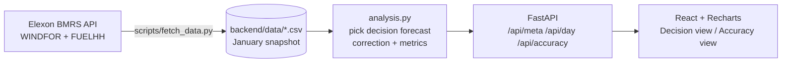

# Wind Forecast Desk

A web app for a UK utility's day-ahead power buying team. It answers two questions:

1. **What was the latest wind forecast available when we had to decide?** For each delivery day, it shows the forecast the desk could actually see before the day-ahead auction closed. It also shows an adjusted forecast and an uncertainty band.
2. **How much can we trust it?** Accuracy of those decision-time forecasts across January 2026: bias, MAE, error ranges, and breakdowns by lead time, wind level and hour of day.

**Live app:** _<add Vercel URL>_
**Video walkthrough:** _<add unlisted YouTube URL>_

---

## Key findings (January 2026 decisions, 09:00 UK cutoff)

| | Raw forecast | Adjusted forecast |
|---|---|---|
| Typical hourly error (MAE) | 1,988 MW | 1,385 MW (−30%) |
| Average bias (forecast − actual) | +1,702 MW | +48 MW |
| Error as share of output | 17.8% | 12.4% |

*Raw vs adjusted is compared over the 30 delivery days with a full week of history. Across all 744 hours, the raw forecast's bias is +1,746 MW.*

- The forecast available at decision time was **too high in 85% of hours**. A desk buying against it would have consistently under-bought.
- The over-forecast appears at **every lead time, even for hours that had already happened** when the forecast was published. So it is mostly not forecasting skill. It is a systematic gap between what WINDFOR forecasts and what FUELHH reports as generated. A likely cause is curtailment or a difference in what each dataset covers (e.g. which wind farms are included). I couldn't confirm this using only these two datasets.
- The gap grows with wind level: about +2.7 GW when the forecast is above 15 GW.
- A simple correction (forecast × last 7 days' actual/forecast ratio, using only data known at the cutoff) removes most of the bias.

## How it works



**Picking the decision forecast.** GB day-ahead auctions close around 09:20–09:50 UK time on the day before delivery. For every target hour on delivery day D, the app uses the **latest WINDFOR forecast published at or before the cutoff on D−1** (default 09:00 UK, adjustable in the UI). Forecasts published later are ignored, because the desk could not have used them. Using the newest forecast instead would overstate accuracy.

**Scope.** "Decisions made in January 2026" means delivery days **2 Jan – 1 Feb 2026**.

**Time alignment.** WINDFOR is hourly and FUELHH is half-hourly. Accuracy is measured on the hour. Interpolating forecasts to half-hours gave the same results (MAE 2,021 vs 2,022 MW). Charts show actuals at full half-hourly resolution.

**Adjusted forecast and band.** For delivery day D: ratio = Σactual / Σforecast over the previous 7 days of hours whose actuals were already known at the cutoff. Adjusted forecast = forecast × ratio. The band is the adjusted forecast + the P10/P90 of the residuals over that same window. A test checks that nothing from after the cutoff is used.

**Error sign.** Error = forecast − actual. Positive means the forecast was too high, i.e. the risk of buying too little.

**Times.** All times are stored in UTC and shown in UK local time. Delivery days and cutoffs are handled in `Europe/London`, so the logic stays correct during British Summer Time (covered by a test).

## Repository layout

```
.
├── backend/
│   ├── app/
│   │   ├── analysis.py      # core logic: decision-forecast selection, correction, metrics (pure pandas)
│   │   ├── data.py          # loads the cached CSV snapshot
│   │   └── main.py          # FastAPI routes
│   ├── data/                # January 2026 snapshot from Elexon (actuals_wind.csv, forecasts_wind.csv)
│   ├── scripts/
│   │   ├── fetch_data.py    # pulls WINDFOR + FUELHH from the Elexon API (chunked, with retries)
│   │   └── explore_data.py  # data profiling: publish schedule, resolution, horizons, first metrics
│   ├── tests/               # pytest: selection logic, no-leakage correction, metrics, API
│   ├── Dockerfile
│   ├── requirements.txt     # runtime deps
│   └── requirements-dev.txt # + fetch script and test deps
├── frontend/
│   ├── src/
│   │   ├── api.ts           # typed API client
│   │   ├── App.tsx          # layout, tabs, cutoff selector
│   │   ├── components/      # DecisionView, AccuracyView, shared UI
│   │   ├── format.ts        # number/time formatting (UK time)
│   │   └── theme.ts         # chart colours (colour-blind safe, light/dark)
│   ├── Dockerfile           # build with Node, serve with nginx
│   └── nginx.conf           # serves the SPA, proxies /api to the backend
├── docker-compose.yml
└── vercel.json              # Vercel Services: frontend at /, FastAPI at /api
```

## Running it

### With Docker (recommended)

```bash
docker compose up --build
```

Open http://localhost:8080. The API is also on http://localhost:8000 (docs at `/docs`).

### Without Docker

```bash
# backend
cd backend
python -m venv .venv && source .venv/bin/activate   # Windows: .venv\Scripts\activate
pip install -r requirements-dev.txt
uvicorn app.main:app --reload --port 8000

# frontend (second terminal)
cd frontend
npm install
npm run dev          # http://localhost:5173, proxies /api to :8000
```

### Tests

```bash
cd backend && pytest
```

### Refreshing the data

The app serves a committed snapshot, because January 2026 is historical and fixed. This keeps the app fast and independent of the Elexon API's uptime. To re-pull it:

```bash
python backend/scripts/fetch_data.py
python backend/scripts/explore_data.py   # sanity-check what came back
```

## Deployment

Deployed on Vercel as one project using [Vercel Services](https://vercel.com/docs/services). The Vite frontend serves `/`, and the FastAPI backend serves `/api/*` (see `vercel.json`). Import the repo in Vercel, and it builds both.

## Design decisions and trade-offs

- **Snapshot instead of live API calls.** The data is fixed history, so a snapshot gives fast, reproducible results. A production version would refresh on a schedule.
- **Pandas in memory, no database.** About 20k rows. Results are cached per cutoff. A database would add moving parts without benefit at this size.
- **Analysis logic kept free of I/O.** All of it lives in `analysis.py`, so it can be unit-tested directly.
- **Simple, explainable correction.** A multiplicative trailing ratio was chosen over a fitted model because the client can understand and audit it. A level-dependent correction is a natural next step, since the bias grows with wind level.

## Next steps

- Add more months to test whether the bias pattern persists.
- Add other renewables and demand forecasts, so the app shows the actual residual volume to buy.
- Use a level-dependent correction and calibrated probabilistic bands.
- Schedule automatic data refreshes.

## Use of AI tools

_<Fill in honestly — the challenge asks for this explicitly. For example: which parts you wrote, which parts an AI assistant (Claude) scaffolded or implemented, which parts you reviewed and changed, and what you used ChatGPT/Gemini for (e.g. domain research).>_
