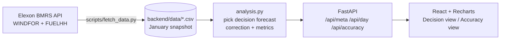

# Wind Forecast Desk

A web app for a UK utility's day-ahead power buying team. It answers two questions:

1. **What was the latest wind forecast available when we had to decide?** For each delivery day, it shows the forecast the desk could actually see before the day-ahead auction closed. It also shows an adjusted forecast and an uncertainty band.
2. **How much can we trust it?** Accuracy of those decision-time forecasts across January 2026: bias, MAE, error ranges, and breakdowns by lead time, wind level and hour of day.

**Live app:** _<add Vercel URL>_
**Video walkthrough:** _<add unlisted YouTube URL>_

---

## Key findings (January 2026 decisions, 09:00 UK cutoff)

| | Raw forecast | Adjusted forecast |
|---|---|---|
| Typical hourly error (MAE) | 2,022 MW | 1,383 MW (−32%) |
| Average bias (forecast − actual) | +1,746 MW | +320 MW (~82% removed) |
| Error as share of output | 17.9% | 12.2% |
| Hours over-forecast | 85% | 55% |

*Raw and adjusted are compared on the same 744 hours (31 delivery days, each with a full week of history).*

- The forecast available at decision time was **too high in 85% of hours**, by +1,746 MW on average. A desk buying against it would have consistently under-bought.
- **The correction removes ~82% of the bias and cuts typical error by ~32%; it beat the raw forecast on 22 of 31 days.**
- The over-forecast appears at **every lead time, about 1.5–2 GW, even for hours that had already happened** when the forecast was published (+1.7 GW). So it is mostly not forecasting skill. It is a systematic gap between what WINDFOR forecasts and what FUELHH reports as generated. A likely cause is curtailment or a difference in what each dataset covers (e.g. which wind farms are included). I couldn't confirm this using only these two datasets.
- The gap grows with wind level: about +2.7 GW when the forecast is above 15 GW (still about +1.0 GW after the correction).
- **The uncertainty band under-covers: the actual fell inside it in 69% of hours, against an 80% target.** See *Limitations*.

## How it works



**Picking the decision forecast.** GB day-ahead auctions close around 09:20–09:50 UK time on the day before delivery. For every target hour on delivery day D, the app uses the **latest WINDFOR forecast published at or before the cutoff on D−1** (default 09:00 UK, adjustable in the UI). Forecasts published later are ignored, because the desk could not have used them. Using the newest forecast instead would overstate accuracy.

**Scope.** "Decisions made in January 2026" means delivery days **2 Jan – 1 Feb 2026**.

**Delivery day.** A delivery day is the UK calendar day (00:00–24:00 Europe/London). GB day-ahead auction products actually run 23:00–23:00 UK; re-running with that definition changed raw bias and MAE by less than 0.2% and adjusted MAE by about 1% (1,383 → 1,369 MW), so the simpler calendar day is kept.

**Time alignment.** WINDFOR is hourly and FUELHH is half-hourly. Accuracy is measured on the hour. Interpolating forecasts to half-hours gave the same results (MAE 2,021 vs 2,022 MW). Charts show actuals at full half-hourly resolution.

**Adjusted forecast and band.** For delivery day D: ratio = Σactual / Σforecast over the previous 7 days of hours whose actuals were already known at the cutoff. Adjusted forecast = forecast × ratio. The band is the adjusted forecast + the P10/P90 of out-of-sample residuals over that same window: for each history hour, actual minus that day's own adjusted forecast (made with its own prior ratio), so the band reflects errors the method really made. In January the actual fell inside the band in 69% of hours at a 09:00 cutoff, not the nominal 80%; the app shows the measured figure. A test checks that nothing from after the cutoff is used.

**When an actual counts as known.** A FUELHH half-hour is treated as known once it has ended (startTime + 30 min ≤ cutoff), i.e. assuming it is published with no lag. The snapshot supports this: 99.8% of half-hours carry a publishTime within 5 minutes of the period end. If Elexon's real availability lagged, the last half-hour or so before the cutoff would drop out of a 168-hour window.

**Error sign.** Error = forecast − actual. Positive means the forecast was too high, i.e. the risk of buying too little.

**Times.** All times are stored in UTC and shown in UK local time. Delivery days and cutoffs are handled in `Europe/London`, so the logic stays correct during British Summer Time (covered by a test).

## Repository layout

```
.
├── backend/
│   ├── app/
│   │   ├── analysis.py      # core logic: decision-forecast selection, correction, metrics (pure pandas)
│   │   ├── data.py          # loads the cached CSV snapshot
│   │   └── main.py          # FastAPI routes
│   ├── data/                # January 2026 snapshot from Elexon (actuals_wind.csv, forecasts_wind.csv, manifest.json)
│   ├── scripts/
│   │   ├── fetch_data.py    # pulls WINDFOR + FUELHH from the Elexon API (chunked, with retries)
│   │   └── explore_data.py  # data profiling: publish schedule, resolution, horizons, first metrics
│   ├── tests/               # pytest: selection logic, no-leakage correction, metrics, API
│   ├── Dockerfile
│   ├── requirements.txt     # runtime deps
│   └── requirements-dev.txt # + fetch script and test deps
├── frontend/
│   ├── src/
│   │   ├── api.ts           # typed API client
│   │   ├── App.tsx          # layout, tabs, cutoff selector
│   │   ├── components/      # DecisionView, AccuracyView, shared UI
│   │   ├── format.ts        # number/time formatting (UK time)
│   │   └── theme.ts         # chart colours (colour-blind safe, light/dark)
│   ├── Dockerfile           # build with Node, serve with nginx
│   └── nginx.conf           # serves the SPA, proxies /api to the backend
├── analysis/                # out-of-app validation: validate.py + Nov 2025 – Mar 2026 data (not deployed)
├── docs/validation.md       # validation and sensitivity tables
├── docker-compose.yml
└── vercel.json              # Vercel Services: frontend at /, FastAPI at /api
```

## Running it

### With Docker (recommended)

```bash
docker compose up --build
```

Open http://localhost:8080. The API is also on http://localhost:8000 (docs at `/docs`).

### Without Docker

```bash
# backend
cd backend
python -m venv .venv && source .venv/bin/activate   # Windows: .venv\Scripts\activate
pip install -r requirements-dev.txt
uvicorn app.main:app --reload --port 8000

# frontend (second terminal)
cd frontend
npm install
npm run dev          # http://localhost:5173, proxies /api to :8000
```

### Tests

```bash
cd backend && pytest
```

### Refreshing the data

The app serves a committed snapshot, because January 2026 is historical and fixed. This keeps the app fast and independent of the Elexon API's uptime. To re-pull it:

```bash
python backend/scripts/fetch_data.py
python backend/scripts/explore_data.py   # sanity-check what came back
```

## Deployment

Deployed on Vercel as one project using [Vercel Services](https://vercel.com/docs/services). The Vite frontend serves `/`, and the FastAPI backend serves `/api/*` (see `vercel.json`). Import the repo in Vercel, and it builds both.

## Design decisions and trade-offs

- **Snapshot instead of live API calls.** The data is fixed history, so a snapshot gives fast, reproducible results. A production version would refresh on a schedule.
- **Pandas in memory, no database.** About 30k rows. Results are cached per cutoff. A database would add moving parts without benefit at this size.
- **Analysis logic kept free of I/O.** All of it lives in `analysis.py`, so it can be unit-tested directly.
- **Simple, explainable correction.** A multiplicative trailing ratio was chosen over a fitted model because the client can understand and audit it. A level-dependent correction is a natural next step, since the bias grows with wind level.

## Validation on other months

The same method, run unchanged on decisions from Nov 2025 to Mar 2026, removes 82–102% of the bias and cuts MAE by 10–54% in every month, and beats a simpler "subtract last week's mean error" baseline every month. The band under-covers in every month (64–73% vs 80%); 14 days of residuals helps everywhere but never reaches 80%. Details and sensitivity tables (ratio window, band window, cutoff, baseline): [docs/validation.md](docs/validation.md).

## Limitations

- **The band holds the actual in 69% of hours, not 80%.** Errors are strongly correlated within a day, so the trailing week's 168 hourly residuals are really about seven day-sized draws, and the band under-covers when conditions shift between that week and the delivery day. On the worst days the actual fell outside the band in every hour: 2, 11, 21 and 28 Jan. Each was a day when the actual/forecast ratio dropped well below the trailing week's (28 Jan: 0.52 vs 0.87), consistent with curtailment or other output losses changing, though that cause is not confirmed with these two datasets.
- **One month.** All figures are January 2026 only.

## Next steps

- Add more months to test whether the bias pattern persists.
- Add other renewables and demand forecasts, so the app shows the actual residual volume to buy.
- Calibrated bands, chosen only after out-of-sample validation on other months, not tuned on January.
- A level-dependent correction, since the bias grows with wind level.
- Schedule automatic data refreshes.

## Use of AI tools

_<Fill in honestly — the challenge asks for this explicitly. For example: which parts you wrote, which parts an AI assistant (Claude) scaffolded or implemented, which parts you reviewed and changed, and what you used ChatGPT/Gemini for (e.g. domain research).>_
