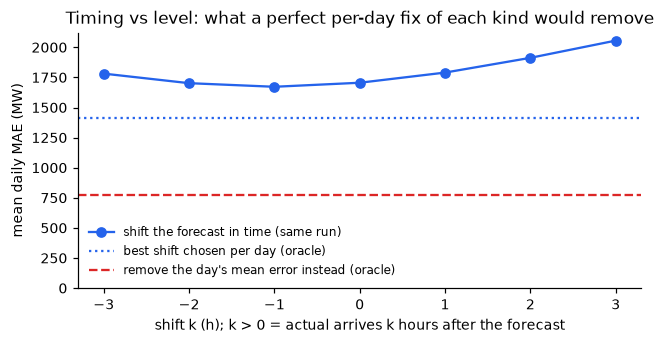
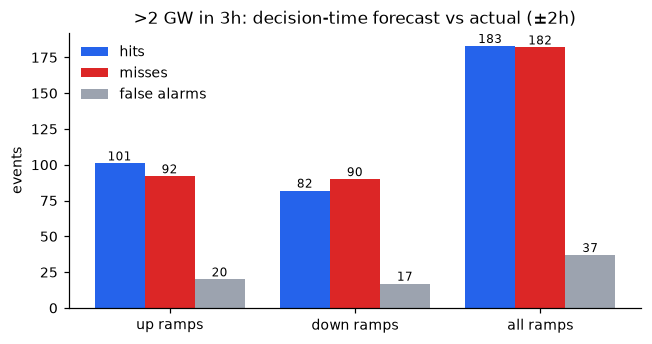
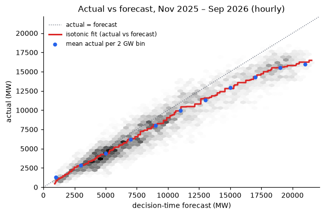
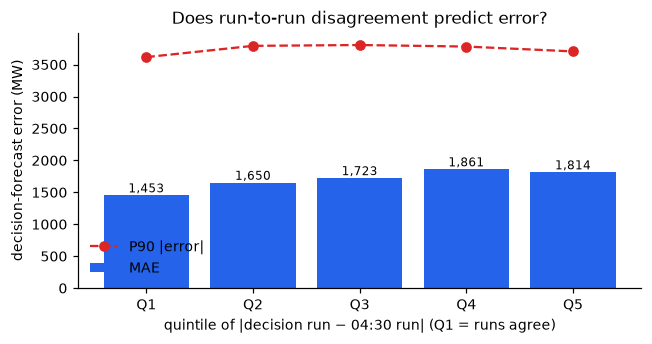
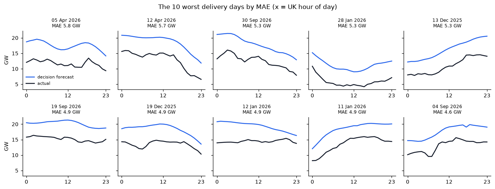

# Anatomy of the forecast error

What kind of error is the decision-time wind forecast making? This page breaks it down. It covers decisions made 1 Nov 2025 – 30 Sep 2026: 334 delivery days and 8,015 hours, including the 29 Mar clock change. Over that period the raw forecast's bias is +1,351 MW and its MAE is 1,706 MW. It is analysis only: `analysis/error_anatomy.py` uses the app's own selection logic unchanged, and nothing in the app was changed. No forecast published, and no actual timestamped, before 1 Nov 2025 is used.

- **Decision forecast:** the latest WINDFOR run published at or before 09:00 UK on D−1, as in the app. Error = forecast − actual, so + means the forecast was too high.
- **Run schedule:** WINDFOR's run times shift with British Summer Time. The last run before 09:00 UK is the 07:30 UK run in winter and the 06:30 UK run in summer. There is no 07:30 run in summer.
- **Reproduce:** `python analysis/error_anatomy.py` (data fetch commands are in the script header).

## 1. Timing or size?

| shift (k > 0: actual arrives later) | mean daily MAE (MW) | days where this shift is best |
|---|---|---|
| −3h | 1,782 | 99 |
| −2h | 1,702 | 50 |
| −1h | 1,672 | 42 |
| 0h | 1,706 | 38 |
| +1h | 1,790 | 22 |
| +2h | 1,913 | 16 |
| +3h | 2,056 | 67 |

The error is mostly in level, not timing: each day's own mean error accounts for 78% of the squared error. With hindsight, the best shift for each day cuts MAE by only 17% (1,706 → 1,409 MW), while removing each day's mean error cuts it by 55% (to 771 MW) and is the better fix on 73% of days. The best shift sits at the edge of the range (±3h) on half the days, so it is mostly sliding along a sloping profile to reduce a level error, not correcting a genuine timing error.

## 2. Ramps (>2 GW within 3 hours)

| ramps | timing tolerance | actual events | forecast events | hits | misses | false alarms | hit rate | false-alarm ratio |
|---|---|---|---|---|---|---|---|---|
| up | ±2h | 193 | 98 | 101 | 92 | 20 | 52% | 20% |
| down | ±2h | 172 | 91 | 82 | 90 | 17 | 48% | 19% |
| all | ±2h | 365 | 189 | 183 | 182 | 37 | 50% | 20% |
| all | exact hour | 365 | 189 | 152 | 213 | 52 | 42% | 28% |

The decision-time forecast catches only half of the ~30 ramps a month (183 of 365, allowing ±2 hours), and it is equally weak on up and down ramps. When it does predict a ramp it is usually right (80% are matched), but it predicts too few: 189 against 365 actual. When the actual ramps, the forecast's 3-hour change is typically only 68% as large, so the forecast is too smooth to warn a desk about ramps.

## 3. Is output capped at high wind?

| forecast | hours | mean actual | actual / forecast | P90 actual | isotonic fit | fit slope |
|---|---|---|---|---|---|---|
| 0–2 GW | 203 | 1,287 | 0.88 | 2,171 | 676 | – |
| 2–4 GW | 742 | 2,884 | 0.92 | 4,108 | 2,863 | 1.09 |
| 4–6 GW | 1,243 | 4,386 | 0.88 | 5,809 | 4,265 | 0.70 |
| 6–8 GW | 1,141 | 6,225 | 0.89 | 8,240 | 6,253 | 0.99 |
| 8–10 GW | 1,106 | 8,032 | 0.89 | 10,046 | 8,128 | 0.94 |
| 10–12 GW | 916 | 9,956 | 0.91 | 12,270 | 9,907 | 0.89 |
| 12–14 GW | 676 | 11,297 | 0.88 | 13,424 | 11,581 | 0.84 |
| 14–16 GW | 536 | 12,912 | 0.86 | 15,007 | 12,809 | 0.61 |
| 16–18 GW | 571 | 14,311 | 0.84 | 16,106 | 14,350 | 0.77 |
| 18–20 GW | 666 | 15,538 | 0.82 | 17,108 | 15,519 | 0.58 |
| 20–22 GW | 215 | 15,977 | 0.78 | 17,460 | 16,240 | 0.36 |

Output flattens at high wind but is not pinned at one value. Actual output tracks about 0.9× the forecast up to ~12 GW, the fitted slope falls to 0.36 above 20 GW, and actual never exceeds 18.4 GW (99th percentile 17.4 GW) although the forecast reaches 21.5 GW; only 0.9% of half-hours are within 1 GW of the maximum. Some flattening is expected anyway, because a noisy forecast's extreme values tend to overshoot, so this alone can't separate a real limit (curtailment, or metering that covers only part of the fleet) from that statistical effect.

## 4. Does run-to-run disagreement predict the error?

| quintile of disagreement (decision run vs 04:30 run) | disagreement (MW) | hours | MAE (MW) | bias (MW) | P90 \|error\| (MW) |
|---|---|---|---|---|---|
| Q1 | 0–30 | 1,616 | 1,453 | +1,229 | 3,618 |
| Q2 | 31–80 | 1,584 | 1,650 | +1,373 | 3,794 |
| Q3 | 81–145 | 1,602 | 1,723 | +1,445 | 3,807 |
| Q4 | 146–288 | 1,602 | 1,861 | +1,536 | 3,783 |
| Q5 | 289–2,975 | 1,587 | 1,814 | +1,138 | 3,707 |

Disagreement between runs is only a weak signal: its Spearman correlation with the absolute error is 0.14 hour by hour and 0.28 day by day, and MAE rises only from 1,453 MW (Q1) to 1,814 MW (Q5), not steadily. Forecast level predicts the error far better (Spearman 0.56), and within low, middle and high forecast levels disagreement adds little or nothing (0.23, 0.05, −0.15; −0.06 in winter). It is not a free uncertainty signal, at least for these two runs.

## 5. The 10 worst days

| delivery day | MAE | bias | mean forecast → actual | actual / forecast | MAE after removing day's mean error | best shift (MAE) | run disagreement (percentile) |
|---|---|---|---|---|---|---|---|
| Sun 05 Apr 2026 | 5,817 | +5,817 | 17.5 → 11.7 GW | 0.67 | 780 | −3h (4,942) | 109 MW (45%) |
| Sun 12 Apr 2026 | 5,660 | +5,660 | 18.6 → 12.9 GW | 0.70 | 503 | −3h (4,228) | 161 MW (60%) |
| Wed 30 Sep 2026 | 5,344 | +5,344 | 17.8 → 12.5 GW | 0.70 | 887 | −3h (4,066) | 116 MW (47%) |
| Wed 28 Jan 2026 | 5,329 | +5,329 | 11.1 → 5.8 GW | 0.52 | 430 | −3h (5,173) | 0 MW (2%) |
| Sat 13 Dec 2025 | 5,276 | +5,276 | 16.2 → 10.9 GW | 0.67 | 620 | +3h (4,198) | 687 MW (98%) |
| Sat 19 Sep 2026 | 4,947 | +4,947 | 20.2 → 15.2 GW | 0.75 | 611 | −3h (4,752) | 45 MW (11%) |
| Fri 19 Dec 2025 | 4,902 | +4,902 | 18.4 → 13.5 GW | 0.73 | 1,002 | −3h (4,087) | 154 MW (58%) |
| Mon 12 Jan 2026 | 4,875 | +4,875 | 19.3 → 14.4 GW | 0.75 | 1,382 | −3h (4,200) | 115 MW (46%) |
| Sun 11 Jan 2026 | 4,853 | +4,853 | 18.4 → 13.5 GW | 0.74 | 666 | +3h (3,597) | 112 MW (45%) |
| Fri 04 Sep 2026 | 4,602 | +4,602 | 17.6 → 13.0 GW | 0.74 | 607 | +3h (3,921) | 88 MW (33%) |

All ten worst days have the same shape: the forecast was too high in every hour (bias equals MAE, 4.6–5.8 GW) by a fairly steady 25–48%, and once the day's mean error is removed only 430–1,382 MW of error remains. Nine are high-wind days (forecast 16–20 GW), several with actual output sitting flat at 14–16 GW, and neither run disagreement (median percentile 45%) nor a time shift would have flagged or fixed them. Half fall on a weekend, including Easter Sunday, against 28% of all days, which hints at curtailment when demand is low, but ten days is too few to show it.

## What this suggests trying

None of these have been tried yet, and nothing in the app has changed. Each should be checked on months not used to choose it.

- **A level-dependent correction.** Scale high forecasts down more than low ones, for example with an isotonic or piecewise curve fitted on a trailing window. The plateau and the worst days both point to errors that grow at high wind, and a single ratio cannot follow that.
- **Explaining level rather than shape.** On the worst days the shape of the forecast was right but its level was wrong. Data on curtailment, demand or day type (BMRS bid–offer acceptances or system prices, demand forecasts, weekends and holidays) could explain the gap where timing fixes cannot.
- **Ramp warnings from more than the decision run.** For example, flag a ramp if any recent run shows one, or lower the threshold for the smooth forecast, and measure the trade-off between hits and false alarms. The decision run alone misses half of ramps.
- **Dropping run-to-run disagreement as an uncertainty signal.** Make the band depend on forecast level instead, which predicts error far better (Spearman 0.56 vs 0.14).
- **Checking the summer cutoff.** In summer the 09:00 cutoff picks up the 06:30 UK run because there is no 07:30 run, so summer decisions use an older forecast. That only matters if the app's scope extends beyond January.
