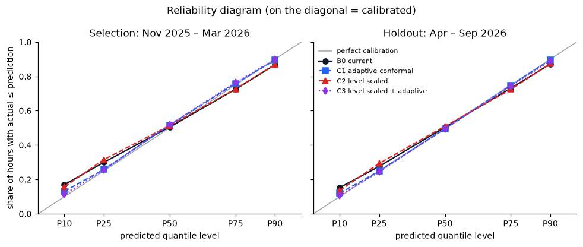

# Uncertainty band: evaluation and candidates

## Decision rule (written and committed before any band was evaluated)

The rule below was committed to git before any of the numbers on this page were computed, including the current band's. It is applied exactly as written; the commit history shows it was not edited after the results were known.

### What "calibrated but wide" vs "sharp but wrong" means for a trader

A *calibrated* band contains the actual as often as it claims to: an 80% band misses about 1 hour in 5, P10 is undershot about 10% of the time, and so on. A *sharp* band is narrow. A band that is calibrated but wide is honest but not very useful: the trader can trust that the worst case really is a plausible worst case, but it covers so much that the decision barely changes, and hedging against all of it costs money. A band that is sharp but wrong is dangerous. It looks precise, so the trader sizes positions to it, but it misses far more often than stated, and those misses arrive as unhedged imbalance exposure on exactly the days that matter. The goal is the sharpest band that stays calibrated. Pinball loss scores both properties together: it penalises a quantile for being on the wrong side of the actual, weighted by how far off it is, so it can't be gamed by simply widening or narrowing the band.

### Data and scoring

- **Data:** `analysis/data` and `analysis/data-2026-04-09`. Nothing published or timestamped before 1 Nov 2025 is read.
- **Decision forecast and adjusted forecast:** the app's own logic (`analysis.py`), with a 09:00 UK cutoff, a 7-day ratio and actuals counted as known once startTime + 30 min ≤ cutoff.
- **Days scored:** only delivery days whose band rests on a full 168-hour window of out-of-sample residuals, so the first ~2 weeks of November warm up and are not scored. A month is the month of the decision (D−1), as in `docs/validation.md`.
- **Quantile levels:** q ∈ {0.10, 0.25, 0.50, 0.75, 0.90}. Each band produces a predicted value at every q.
- **Metrics per month:**
  - coverage of the P10–P90 interval (share of hours with P10 ≤ actual ≤ P90);
  - reliability: the share of hours with actual ≤ predicted q, for each q;
  - pinball loss averaged over the five q and all hours;
  - mean P10–P90 width.

### Bands

- **B0, the current band.** adjusted + the q-quantile of out-of-sample residuals (actual − adjusted) over the trailing 7 days of known hours. This is the app's band, extended from P10/P90 to all five q.
- **C1, rolling (adaptive) conformal.** Same as B0, but the quantile level used for each q is adjusted online, as in adaptive conformal inference.
  - Each q starts at a_q = q.
  - Before each delivery day D, a_q += γ · Σ (q − 1{actual ≤ predicted q}), summed over every hour whose actual became known between the previous delivery day's cutoff and D's cutoff, using the prediction that was made for that hour.
  - a_q is clipped to [0.005, 0.995], and γ = 0.005 per hour is fixed in advance and not tuned.
  - Why: the anatomy found errors arrive in regimes (whole days off), and C1 tracks recent misses.
- **C2, width scaled by forecast level.** adjusted × (1 + q-quantile of relative residuals (actual − adjusted) / adjusted) over the same trailing 7 days.
  - Why: forecast level is the strongest predictor of error size found (Spearman 0.56, anatomy §4), and the plateau makes errors grow at high wind (anatomy §3).
- **C3, C2 plus C1's adaptive levels.** Same update rule and γ as C1.
- **Not tested: width scaled by run-to-run disagreement.** Anatomy §4 found it adds nothing once forecast level is controlled for (Spearman 0.23, 0.05 and −0.15 within forecast-level terciles).

### Selection, using decision months Nov 2025 – Mar 2026

The finalist is the candidate (C1, C2 or C3) with the lowest pinball loss pooled over all scored selection hours. That pooled loss must also be lower than B0's. If no candidate beats B0 on the selection months, nothing goes to the holdout and the app is unchanged.

### Confirmation, using decision months Apr – Sep 2026 (6 months)

Only the finalist is tested. It is **adopted** only if both of these hold:

1. its P10–P90 coverage is within 5 percentage points of 80% (75%–85% inclusive) in **at least 5 of the 6** holdout months; **and**
2. its pinball loss is strictly lower than B0's in **at least 5 of the 6** holdout months.

Otherwise it is rejected, and the app keeps B0. Whatever the outcome, every band's results are reported for every month.

### If adopted

It is implemented in the app test-first, the golden test and README are updated, and the app's January figures are recomputed. The holdout is not used to tune anything.

---

## Results (computed after the rule above was committed)

Produced by `python analysis/uncertainty.py`. 324 delivery days were scored (12 Nov 2025 – 1 Oct 2026, 7,775 hours): 3,383 hours in selection and 4,392 in holdout. The script checks that B0 reproduces the app's band exactly. The January B0 coverage, 69%, matches the app.

### 1. The current band (B0)

| predicted quantile (target share below) | selection, Nov–Mar (3,383 h) | holdout, Apr–Sep (4,392 h) |
|---|---|---|
| P10 (10%) | 17% | 15% |
| P25 (25%) | 30% | 28% |
| P50 (50%) | 51% | 50% |
| P75 (75%) | 73% | 73% |
| P90 (90%) | 87% | 87% |

| month | hours | P10–P90 coverage | pinball (MW) | mean width (MW) |
|---|---|---|---|---|
| 2025-11 | 480 | 70% | 615 | 4,976 |
| 2025-12 | 744 | 71% | 635 | 4,634 |
| 2026-01 | 744 | 69% | 595 | 4,838 |
| 2026-02 | 672 | 64% | 471 | 3,506 |
| 2026-03 | 743 | 73% | 400 | 3,192 |
| 2026-04 | 720 | 73% | 426 | 3,529 |
| 2026-05 | 744 | 68% | 374 | 2,898 |
| 2026-06 | 720 | 78% | 374 | 3,184 |
| 2026-07 | 744 | 75% | 356 | 2,673 |
| 2026-08 | 744 | 74% | 354 | 2,716 |
| 2026-09 | 720 | 63% | 517 | 3,627 |

B0 is well calibrated in the middle: P50 is undershot 50–51% of the time. The misses are in the tails, especially the low one. The actual falls below P10 in 15–17% of hours instead of 10%, and below P90 in 87% instead of 90%. So the 80% band holds 63–78% of hours depending on the month. In trader terms, B0 is *sharp and slightly wrong*: the downside is under-stated most, which is exactly the under-buying risk.

### 2. Selection (Nov 2025 – Mar 2026, pooled)

| band | P10–P90 coverage | pinball (MW) | mean width (MW) |
|---|---|---|---|
| B0 current | 69.7% | **539.3** | 4,187 |
| C1 adaptive conformal | 76.4% | 576.1 | 5,209 |
| C2 level-scaled | 71.1% | 553.7 | 4,969 |
| C3 level-scaled + adaptive | 78.5% | 596.3 | 6,360 |

The lowest-loss candidate is C2 at 553.7, but B0 is lower still at 539.3. **No candidate beats the current band on the selection months, so by the rule nothing goes to the holdout, and the app keeps B0.**

### 3. Holdout (Apr – Sep 2026), reported for transparency only

The rule says no finalist is tested. This table shows how C2, the would-be finalist, did, so it's clear the outcome doesn't hinge on that rule. It would also have been rejected: coverage within 75–85% in 2 of 6 months (5 needed), and pinball below B0 in 4 of 6 (5 needed).

| month | C2 coverage | within 75–85% | C2 pinball | B0 pinball | beats B0 |
|---|---|---|---|---|---|
| 2026-04 | 76.5% | yes | 429.9 | 426.0 | no |
| 2026-05 | 69.9% | no | 378.0 | 374.1 | no |
| 2026-06 | 72.4% | no | 368.1 | 374.0 | yes |
| 2026-07 | 74.1% | no | 351.3 | 356.4 | yes |
| 2026-08 | 74.9% | no | 342.6 | 354.2 | yes |
| 2026-09 | 75.0% | yes | 492.2 | 517.0 | yes |

### 4. Every band, every month (coverage / pinball MW / width MW)

| month | B0 current | C1 adaptive conformal | C2 level-scaled | C3 level-scaled + adaptive |
|---|---|---|---|---|
| 2025-11 | 70% / 615 / 4,976 | 79% / 652 / 6,365 | 71% / 632 / 6,272 | 83% / 677 / 7,552 |
| 2025-12 | 71% / 635 / 4,634 | 75% / 671 / 5,285 | 67% / 647 / 4,854 | 73% / 669 / 5,508 |
| 2026-01 | 69% / 595 / 4,838 | 77% / 661 / 6,033 | 77% / 590 / 5,475 | 81% / 642 / 6,627 |
| 2026-02 | 64% / 471 / 3,506 | 73% / 484 / 4,396 | 65% / 484 / 3,973 | 74% / 514 / 5,316 |
| 2026-03 | 73% / 400 / 3,192 | 79% / 431 / 4,297 | 75% / 436 / 4,636 | 83% / 501 / 7,120 |
| 2026-04 | 73% / 426 / 3,529 | 78% / 451 / 4,178 | 77% / 430 / 4,503 | 81% / 478 / 6,012 |
| 2026-05 | 68% / 374 / 2,898 | 78% / 402 / 3,600 | 70% / 378 / 3,025 | 74% / 404 / 3,465 |
| 2026-06 | 78% / 374 / 3,184 | 81% / 398 / 3,859 | 72% / 368 / 3,468 | 78% / 388 / 4,382 |
| 2026-07 | 75% / 356 / 2,673 | 78% / 383 / 3,463 | 74% / 351 / 2,731 | 81% / 382 / 3,884 |
| 2026-08 | 74% / 354 / 2,716 | 77% / 382 / 3,443 | 75% / 343 / 3,090 | 78% / 370 / 3,795 |
| 2026-09 | 63% / 517 / 3,627 | 75% / 535 / 4,713 | 75% / 492 / 4,775 | 78% / 518 / 5,882 |

### What this shows

The adaptive bands C1 and C3 do what conformal methods promise: their coverage moves close to 80% in almost every month. But they get there by widening the band by 24–52%, and that costs more pinball loss than the misses it removes. This is *calibrated but wide* in practice: a trader would get an honest band that barely narrows the decision.

The level-scaled band C2 is the most interesting. It beats B0 on pinball in June–September and January, but loses in the other six months. It is not consistent enough to pass a rule written in advance.

The likely reason all three fall short is the one found in `docs/error-anatomy.md`. The big misses are whole days with a level error (worst days 25–48% too high), and no amount of reshaping last week's residuals predicts those. A better band probably needs an input that explains them, such as curtailment, demand or day-type data, rather than a better treatment of the same residuals.

### Decision

**Rejected under the pre-registered rule. The app keeps the current band (B0)**, which is still labelled with its measured coverage. Any new candidate should be chosen on these eleven months and confirmed on data from October 2026 onwards, because these holdout months have now been seen.
